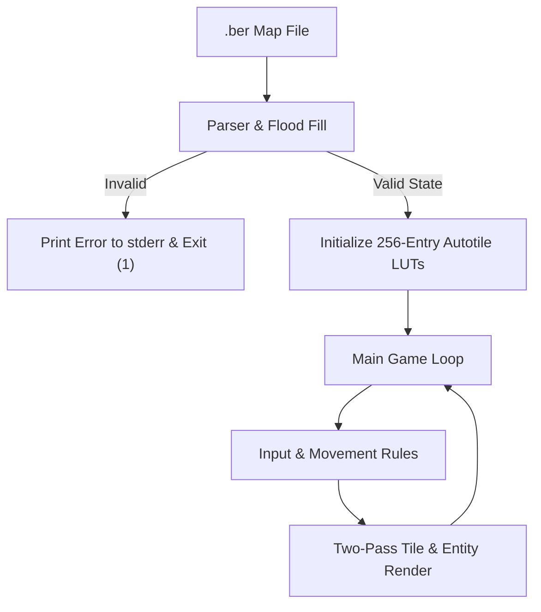

# Architecture Overview

`so_long` separates **map validation**, **game state**, and **rendering** into distinct modules. Keeping game state independent from window management avoids coupling simulation rules to draw calls and allows map validation and movement logic to be verified directly from the CLI.

---

## Repository Layout

```text
so_long/
├── assets/             # Sprite sheets and sample .ber maps
├── include/            # Public headers, data structures, and bitmask definitions
├── src/
│   ├── main.c          # Entry point and CLI routing
│   ├── parser/         # .ber file loading, structural validation, and flood-fill checks
│   ├── game/           # Movement rules, collision handling, and win/loss state updates
│   └── render/         # Autotiling LUT initialization, neighbor bitmasking, and sprite drawing
└── test/               # Map fixtures (valid/invalid), parser test script, and logic assertions
```

---

## Execution Flow



### Binary CLI Entry Points

| Invocation | Behavior | Exit Status |
| :--- | :--- | :--- |
| `./build/so_long <valid.ber>` | Validates map, opens window, and runs game loop | `0` on normal exit (`ESC` or window close) |
| `./build/so_long <invalid.ber>` | Writes an error to `stderr` before initializing window | `1` |
| `./build/so_long` (wrong arg count) | Writes usage error to `stderr` | `1` |
| `./build/so_long --test` | Runs headless game logic assertions without a window | `0` if all assertions pass |

---

## Core Modules

### Map Parser & Validator
Loads the `.ber` file into a 2D character grid and enforces all structural and gameplay constraints before initializing graphics:
- **Extension & File I/O:** Verifies the `.ber` extension and reads map rows cleanly without trailing newline artifacts.
- **Shape & Boundary Checks:** Ensures uniform row widths and verifies that all perimeter tiles are walls (`1`).
- **Entity Audit:** Counts player (`P`), exit (`E`), and collectible (`C`) tiles, recording initial positions while rejecting unknown characters or invalid counts (`P != 1`, `E != 1`).
- **Reachability (Flood Fill):** Traverses from the player's starting position on a cloned grid to confirm every collectible and the exit can be reached without passing through walls.

### Game State & Logic
A single state structure tracks the live map grid, dimensions, player and exit coordinates, remaining collectibles, move count, and completion status:
- Computes target coordinates from directional input.
- Blocks movement into walls.
- Updates collectible counts, clears collected tiles to floor and triggers the win state upon clearing collectibles and reaching the exit.

### 256-Case Bitmask Autotiling Engine
Rather than branching on neighbor combinations every frame, tile connections are resolved via an **8-bit neighbor bitmask**.

#### Bit Layout
Each tile inspects its 8 surrounding neighbors and sets a bit when a neighbor is **open** (non-wall):

```text
Bit:    7     6     5     4     3     2     1     0
Dir:   NW    SW    SE    NE     W     S     E     N
Val:  128    64    32    16     8     4     2     1
```

#### Lookup Table (LUT) Population
At startup, separate 256-entry lookup tables for walls and floors are populated using a rule-based variant helper that pairs a **required neighbor mask** with an **optional diagonal mask**. Any 8-bit index matching the required bits (after masking out irrelevant diagonals) maps to the same atlas coordinate, compressing 256 cases into a small set of geometric rules while guaranteeing $O(1)$ array lookup during rendering.

#### Deterministic Tile Variants
To break up visual repetition on flat walls and open floors without storing per-tile state, lookups apply a stateless integer avalanche hash seeded by tile coordinates and map dimensions. A percentage threshold preserves the base tile at a fixed rate while distributing decorative variants uniformly, followed by atlas row offsets.

### Rendering Pipeline
Rendering runs across the tile grid followed by a decoupled entity pass:
1. **Base Floor Pass:** Draws a default floor underneath wall tiles and context-aware autotiled floors (with deterministic variant selection) underneath walkable tiles so transparent edges on wall and item sprites blend cleanly.
2. **Tile Foreground Pass:** Draws autotiled walls (applying deterministic variants and biome offsets), frame-animated collectibles, and the exit using atlas coordinates and animation metadata.
3. **Entity Pass:** Renders dynamic entities independently of the grid, smoothly interpolating between discrete grid steps and selecting directional sprite animations (idle vs. running, left vs. right) based on movement state.
---

## Testing & CI

Both test layers run automatically via GitHub Actions (`.github/workflows/ci.yml`) on pushes and pull requests to `main`:

- **Logic Assertions (`./build/so_long --test`):** Runs headless assertions against a test map to verify movement, collisions, collectible decrements, and win conditions.
- **Map Parser Script (`./test/test_maps.sh`):** Executes the binary against valid and malformed `.ber` fixtures (open walls, non-rectangular grids, missing/duplicate entities, unreachable items/exits) and verifies exit codes.
